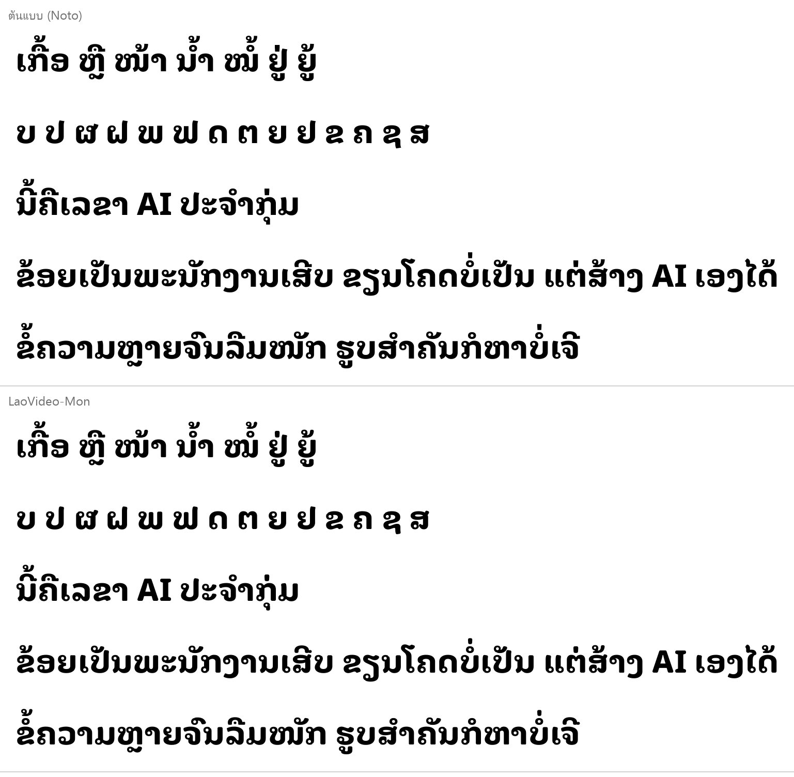
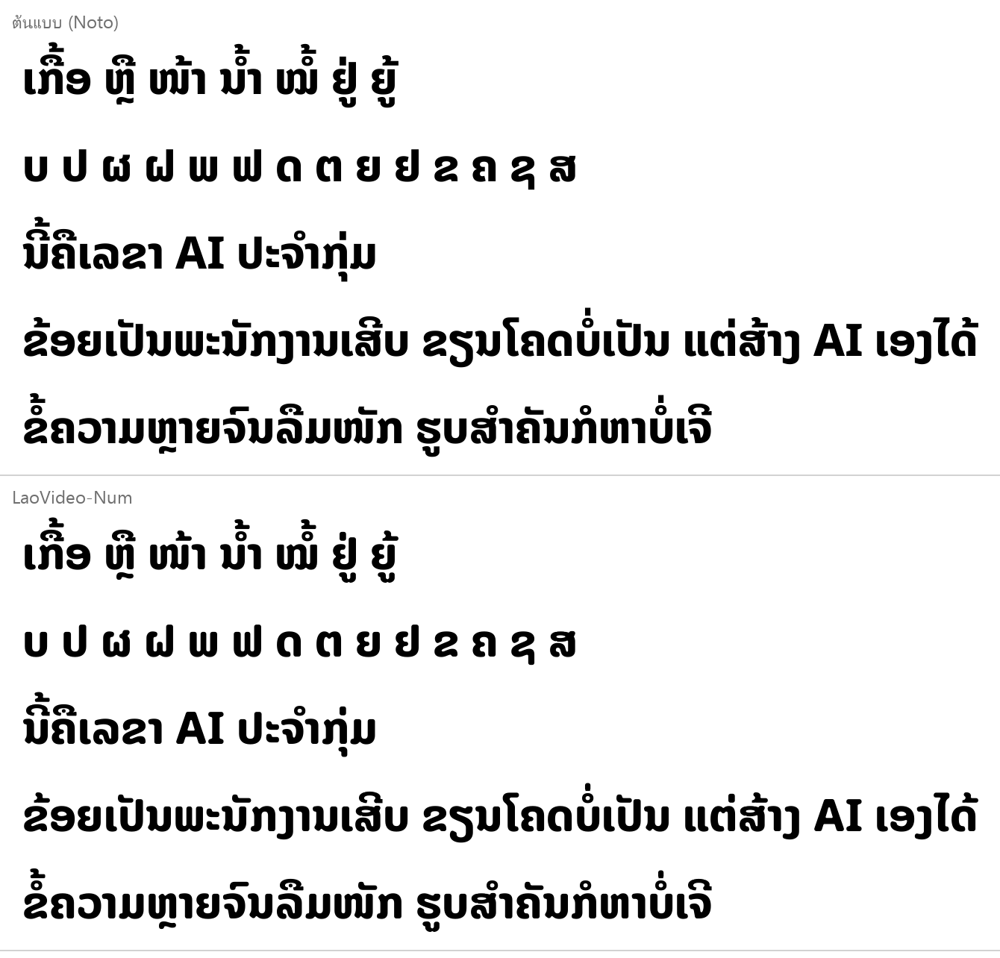

# รายงานตรวจฟอนต์ LaoVideo v1

ทดสอบ **2052 พยางค์** (ทุกพยัญชนะ × สระบน/ล่าง × วรรณยุกต์) + **1207 บรรทัดซับจริง** จาก `data/subs`

## LaoVideo-Mon — ມົນ (หนาโค้งมน)

ต้นแบบ: `NotoSansLaoLooped-VF.ttf` น้ำหนัก 800 · การแปลง: `[['open', 44]]`

| ข้อ | ผล |
|---|---|
| 1. ครบตัวอักษร | ✅ ผ่าน |
| 2. จัดวางเหมือนต้นแบบ | ✅ ผ่าน |
| 3. รูปทรงไม่พัง (ชิ้น/รู/ห่วง) | ✅ ผ่าน |
| 4. แยกตัวอักษรออก | ✅ ผ่าน |
| 5. สระ-วรรณยุกต์ไม่ชนกัน | ✅ ผ่าน |
| 6. ไม่ล้นขอบบน/ล่าง | ✅ ผ่าน |

คู่ที่ใกล้กันที่สุด (ตัวอักษร, ตัวที่คล้าย, ความเหมือนตัวเอง, ความเหมือนตัวที่คล้าย, ระยะห่าง, ระยะห่างในต้นแบบ): [('ໝ', 'ໜ', 1.0, 0.994, 0.006, 0.007), ('ໜ', 'ໝ', 1.0, 0.993, 0.007, 0.007), ('ຩ', 'ໟ', 1.0, 0.985, 0.015, 0.015), ('ໟ', 'ຩ', 1.0, 0.985, 0.015, 0.015), ('ຮ', 'ຣ', 1.0, 0.984, 0.016, 0.017)]

ความสูงหมึกสูงสุด บน/ล่าง = 75/33 px จากขอบที่อนุญาต 88/40 px (ที่ 64px)

## LaoVideo-Khop — ຂອບ (ตัวกลวงมีขอบ (หัวข้อ/ป้าย))

ต้นแบบ: `NotoSansLaoLooped-VF.ttf` น้ำหนัก 900 · การแปลง: `[['open', 20], ['hollow', 46]]`

| ข้อ | ผล |
|---|---|
| 1. ครบตัวอักษร | ✅ ผ่าน |
| 2. จัดวางเหมือนต้นแบบ | ✅ ผ่าน |
| 3. รูปทรงไม่พัง (ชิ้น/รู/ห่วง) | ✅ ผ่าน |
| 4. แยกตัวอักษรออก | ✅ ผ่าน |
| 5. สระ-วรรณยุกต์ไม่ชนกัน | ✅ ผ่าน |
| 6. ไม่ล้นขอบบน/ล่าง | ✅ ผ่าน |

คู่ที่ใกล้กันที่สุด (ตัวอักษร, ตัวที่คล้าย, ความเหมือนตัวเอง, ความเหมือนตัวที่คล้าย, ระยะห่าง, ระยะห่างในต้นแบบ): [('ໝ', 'ໜ', 1.0, 0.995, 0.005, 0.006), ('ໜ', 'ໝ', 1.0, 0.994, 0.006, 0.006), ('ຩ', 'ໟ', 1.0, 0.987, 0.013, 0.013), ('ຮ', 'ຣ', 1.0, 0.987, 0.013, 0.014), ('ໟ', 'ຩ', 1.0, 0.987, 0.013, 0.013)]

ความสูงหมึกสูงสุด บน/ล่าง = 76/35 px จากขอบที่อนุญาต 88/40 px (ที่ 64px)

## LaoVideo-Num — ນຸ່ມ (นุ่มน่ารัก (ไม่มีหัว))

ต้นแบบ: `NotoSansLao-VF.ttf` น้ำหนัก 760 · การแปลง: `[['open', 48], ['close', 22]]`

| ข้อ | ผล |
|---|---|
| 1. ครบตัวอักษร | ✅ ผ่าน |
| 2. จัดวางเหมือนต้นแบบ | ✅ ผ่าน |
| 3. รูปทรงไม่พัง (ชิ้น/รู/ห่วง) | ✅ ผ่าน |
| 4. แยกตัวอักษรออก | ✅ ผ่าน |
| 5. สระ-วรรณยุกต์ไม่ชนกัน | ✅ ผ่าน |
| 6. ไม่ล้นขอบบน/ล่าง | ✅ ผ่าน |

คู่ที่ใกล้กันที่สุด (ตัวอักษร, ตัวที่คล้าย, ความเหมือนตัวเอง, ความเหมือนตัวที่คล้าย, ระยะห่าง, ระยะห่างในต้นแบบ): [('ຐ', '໗', 1.0, 1.0, 0.0, 0.0), ('໗', 'ຐ', 1.0, 1.0, 0.0, 0.0), ('ຫ', 'ທ', 1.0, 0.994, 0.006, 0.007), ('ທ', 'ຫ', 1.0, 0.993, 0.007, 0.007), ('ຮ', 'ຣ', 1.0, 0.984, 0.015, 0.016)]

ความสูงหมึกสูงสุด บน/ล่าง = 75/31 px จากขอบที่อนุญาต 76/30 px (ที่ 64px)

